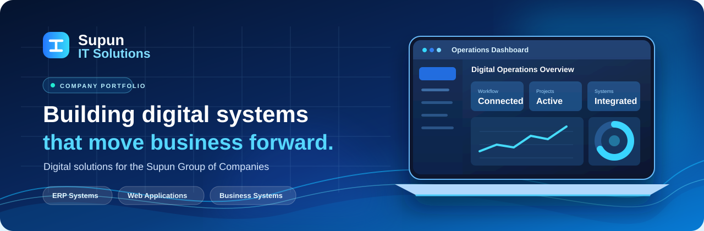

<div align="center">



<br />

# Supun IT Solutions — Company Portfolio

**The digital and IT solutions team within Supun Group of Companies.**

A modern, responsive, single-page portfolio showcasing our company, selected software projects, team, technology stack, and contact information.

[Explore the website sections](#website-sections) · [Our projects](#selected-projects) · [Supun Group](https://supuncompanies.com/) · [Contact](mailto:info@supungroup.lk)


</div>

---

## About

**Supun IT Solutions** designs, develops, and supports digital systems used across the **Supun Group of Companies**. Our focus includes business operations, internal software, ERP workflows, web applications, and digital commerce.

This repository contains the source code for our **company portfolio website**. It presents our work and the people behind it rather than offering an external project-booking service.

## Website sections

| Section | What visitors can explore |
| --- | --- |
| **Home** | A cinematic background-video hero and an introduction to our digital work |
| **About** | Our role within Supun Group, supported business areas, and group-company showcase |
| **Projects** | Animated project carousel, category filters, project details, and selected public website links |
| **Team** | Team profiles and working approach |
| **Tech Stack** | Technologies and tools used across our work |
| **Contact** | Company contact information and an email-ready contact form |

The website uses **smooth, single-page scrolling** while keeping the main navigation visible.

## Highlights

- Cinematic, video-led home hero with playback control
- Premium white, navy, and electric-blue glass design
- Smooth scrolling, responsive layouts, and subtle motion effects
- Animated company logo showcase and project carousel
- Project filters and expandable project descriptions
- Selected public website links, with internal projects kept private
- Team profiles, technology overview, and contact section

## Selected projects

| Project | Focus | Public website |
| --- | --- | --- |
| **Enterprise ERP Systems** | Finance, purchasing, inventory, and manufacturing workflows | Internal system |
| **CAMY Entrepreneurs Digital Platform** | Entrepreneur operations, COD orders, stock, and payouts | [CAMY Market](https://camymarket.com/) |
| **Supun Group Website Redesign** | Group-wide corporate website experience | [Supun Group](https://supuncompanies.com/) |
| **Guest Feedback Management System** | QR-based feedback and service insights | Portfolio overview |
| **AeroSoft360 ERP** | Finance, manufacturing, and inventory workflows | Internal system |
| **Supun Group Costing & Pricing System** | Shipment costing, landed costs, pricing, and reporting | Internal system |
| **AC Service Management System** | AC installations, maintenance, customer records, and support | Internal system |

> **Privacy:** Some projects are internal business systems. This portfolio deliberately does not publish their repository links, private access points, deployment details, or operational configuration. Cover artwork and portfolio descriptions are illustrative, not live system access.

### Coming soon

- **Keep and Care**
- **WIP Project**
- **AnythingAtSupun E-Commerce Platform Redesign**

## Technology

| Area | Stack |
| --- | --- |
| Application | Next.js 16, React 19, TypeScript |
| Styling | Tailwind CSS 4, CSS gradients, responsive design |
| Animations | Framer Motion |
| Icons and media | Lucide React, images, and HTML5 video |
| Development | Node.js, npm, Vinext / Vite-based local tooling |

See the **Tech Stack** section of the website for the broader set of technologies used by the team.

## Getting started

### Requirements

- Node.js **22.13.0 or later**
- npm
- Git

### Run locally

```bash
git clone https://github.com/anulmethnula/Supun-IT-Solutions-Portfolio.git
cd Supun-IT-Solutions-Portfolio/supun-it-solutions
npm install
npm run dev
```

Open the local address shown in your terminal (normally **http://127.0.0.1:5173**).

### Other commands

```bash
npm run build   # Create a production build
npm run lint    # Run ESLint
```

## Project structure

```text
Supun-IT-Solutions-Portfolio/
├── .github/
│   └── assets/            # README banner
├── README.md              # Repository overview
└── supun-it-solutions/
    ├── app/               # Pages and global styles
    ├── public/            # Company images, project covers, videos, logos
    ├── src/
    │   ├── components/    # Reusable UI and interactive components
    │   └── data/          # Company, project, team and site content
    ├── package.json
    └── README.md          # App-specific development notes
```

## Updating content

- Edit the project collection in `supun-it-solutions/src/data/projects.ts`.
- Edit group-company information in `supun-it-solutions/src/data/company.ts`.
- Update navigation and contact details in `supun-it-solutions/src/data/site.ts`.
- Put new images, logos, and video files in the corresponding folders under `supun-it-solutions/public/`.

Please avoid committing confidential credentials or sensitive operational information.

## Contact

**Supun IT Solutions** — part of **Supun Group of Companies**

**Email:** [info@supungroup.lk](mailto:info@supungroup.lk)  
**Group website:** [supuncompanies.com](https://supuncompanies.com/)

---

<div align="center">

**Built around real business operations.**

</div>
